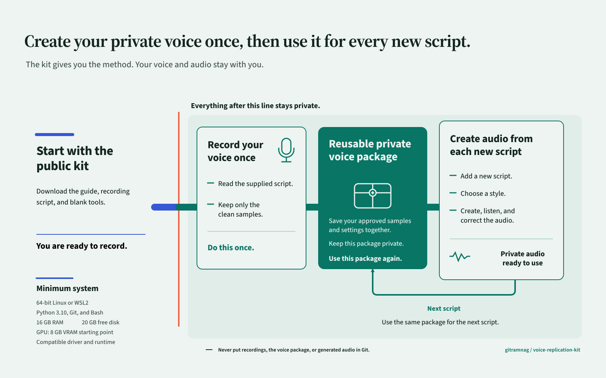

# Voice Replication Kit

[](https://github.com/gitramnag/voice-replication-kit/actions/workflows/ci.yml)

Build and reuse an authorised replica of your own voice with CosyVoice 3. This
privacy-first, open-source voice cloning toolkit gives you a reproducible,
local zero-shot text-to-speech workflow for Windows with WSL2 or Linux.

The public repository is speaker-agnostic. It contains no recording, generated
speech, populated profile, completed scorecard, model snapshot, or other
material that can reproduce a particular person.

Keep all voice-bearing work in an external private root. The commands reject a
private root inside the Git checkout. Read the [privacy boundary](docs/privacy-boundary.md)
before recording anyone.

[](docs/assets/voice-replication-studio-journey.svg)

## The outcome in six steps

The approved [Studio Journey diagram](docs/assets/voice-replication-studio-journey.html)
shows where each part lives, how you build the reusable private package once,
and how that package creates private audio for each later script. You can also
open the static [SVG](docs/assets/voice-replication-studio-journey.svg) or
[PNG](docs/assets/voice-replication-studio-journey.png).

1. Record the public script in your own voice.
   Output: private WAV recordings outside the Git checkout.
2. Test reference clips, seeds and text shapes through Passes 00 to 04.
   Output: private scorecards and one accepted recipe for each needed style.
3. Freeze the accepted recipes in Pass 05.
   Output: a validated private profile that points to your own reference WAVs.
4. Build and validate immutable requests in Pass 06.
   Output: a private request pack bound to the script, profile and model revision.
5. Render one smoke item, listen, then render the batch.
   Output: new 24 kHz WAV files and appended private manifest records.
6. Supply another script and repeat from request construction.
   Output: the same private voice setup is ready for the next script.

The detailed [replication guide](docs/replication-guide.md) expands every step,
including the profile and request formats. The diagram keeps Pass 07 on a
separate maintainer branch. Its reviewed HTML, SVG, and native-size PNG assets
contain no private voice data.

## What each machine needs

Public tooling needs a 64-bit Windows, Linux, or Windows Subsystem for Linux
(WSL) environment with Python 3.10 to 3.12 and enough disk for the source and
tests. Git is needed for a clone and for staged or history publication audits,
but ordinary replication commands also work from an extracted GitHub source
ZIP. Public tooling does not need a GPU, model snapshot, or private audio.

For private inference, start with 16 GB RAM, 20 GB free disk, and a GPU with
8 GB VRAM. These values are starting points, not guarantees. Bootstrap also
needs 64-bit Linux or WSL2, Bash, Git, and Python 3.10. Set `PYTHON_BIN` to a
Python 3.10 executable when `python3.10` is not the correct command.

The reviewed lock uses PyTorch 2.3.1 and CUDA 12.1. Its prebuilt GPU code
supports NVIDIA compute capabilities `sm_50` through `sm_90`. This includes
the RTX 40 series, A100, and H100. It does not support Blackwell GPUs such as
the RTX 50 series at `sm_120`. The reviewed lock does not include an AMD GPU
runtime. A real GPU render was not run here. The authorised user must use the
smoke render to confirm memory and workload compatibility.

## Public preflight

Clone the repository or extract its GitHub source ZIP, then run the public
checks before collecting audio. In the ZIP case, open a shell in the extracted
directory and start with the `python -m venv .venv` command below. The tree
publication check works there; staged and history audits require a Git clone.

Windows PowerShell:

```powershell
$repositoryUrl = Read-Host 'Public repository URL'
git clone $repositoryUrl voice-replication-kit
Set-Location voice-replication-kit
python -m venv .venv
. .\.venv\Scripts\Activate.ps1
python -m pip install --require-hashes -r configs/public-tools-lock.txt
python -m pip install --no-build-isolation --no-deps -e .
python -m pytest -q
python scripts/check_publication.py --root .
```

Bash:

```bash
read -r -p 'Public repository URL: ' REPOSITORY_URL
git clone "$REPOSITORY_URL" voice-replication-kit
cd voice-replication-kit
python3 -m venv .venv
source .venv/bin/activate
python -m pip install --require-hashes -r configs/public-tools-lock.txt
python -m pip install --no-build-isolation --no-deps -e .
python -m pytest -q
python scripts/check_publication.py --root .
```

Expected public output: the tests pass and the publication command prints
`publication boundary check passed`. Next: create the external private root.

The installed command locates the public kit from its module path, not the
shell's current directory. You may run it from a nested directory in either a
clone or extracted source ZIP. A private root still must resolve outside that
public source tree.

## Windows PowerShell path to reusable audio

This path uses PowerShell for public and private data preparation, then WSL for
the pinned Linux GPU runtime. `demo-voice` is a public synthetic workspace
name. The private root stays beneath the current user's local app-data directory.

```powershell
$env:VOICE_KIT_PRIVATE_ROOT = Join-Path $env:LOCALAPPDATA 'voice-replication-kit\demo-voice'
voice-kit init-private
# After recording references and creating upload\evaluation-plan.json:
voice-kit build-matrix
voice-kit build-blind-map
# After listening, freezing upload\private-profile.json, and creating upload\production-script.json:
voice-kit validate-profile
voice-kit build-requests
voice-kit render --validate-only --smoke
$privateRootWsl = (& wsl.exe --exec wslpath -a -u -- "$env:VOICE_KIT_PRIVATE_ROOT").Trim()
if ($LASTEXITCODE -ne 0) { throw 'WSL could not map VOICE_KIT_PRIVATE_ROOT.' }
wsl.exe --exec bash scripts/bootstrap_cosyvoice.sh --private-root "$privateRootWsl"
wsl.exe --exec env "VOICE_KIT_PRIVATE_ROOT=$privateRootWsl" "$privateRootWsl/runtime/venv/bin/voice-kit" render --smoke
```

Inputs before `build-matrix`: private recordings under
`$env:VOICE_KIT_PRIVATE_ROOT\upload\refs` and a valid
`upload\evaluation-plan.json`. Outputs: immutable matrix, blind candidates,
and unblinding map under `evaluation`. Next: listen and record decisions in a
private copy of the scorecard.

Inputs before `validate-profile`: accepted decisions and a populated
`upload\private-profile.json`. Output: a profile whose reference paths and
digests validate. Input before `build-requests`: a valid
`upload\production-script.json`. Output: `upload\requests.jsonl`. The
validation command checks the first request without importing GPU libraries.

After the smoke command, listen to the new WAV under
`results\raw\cosyvoice3`. If it is acceptable, read its request ID from the
last manifest record and render the batch. Inside the pinned runtime, the
smoke action is `voice-kit render --smoke`.

```powershell
$manifest = "$env:VOICE_KIT_PRIVATE_ROOT\results\manifest.jsonl"
$smokeRequestId = (Get-Content $manifest | Select-Object -Last 1 | ConvertFrom-Json).request_id
wsl.exe --exec env "VOICE_KIT_PRIVATE_ROOT=$privateRootWsl" "$privateRootWsl/runtime/venv/bin/voice-kit" render --accept-smoke $smokeRequestId
```

The accepted full batch selects every request in the pack, including the smoke
request again. Outputs are write-once, so that repeated request creates a new
collision-safe output and appends another manifest record instead of replacing
the smoke WAV.

Private output: new 24 kHz WAV files under `results\raw\cosyvoice3` and
appended records in `results\manifest.jsonl`. Next: supply another private
production script and repeat `voice-kit build-requests` with versioned
`--document` and `--output` paths. The setup is ready for the next script.

## Bash path to reusable audio

```bash
export VOICE_KIT_PRIVATE_ROOT=/srv/voice-kit-private/demo-voice
voice-kit init-private
# After recording references and creating upload/evaluation-plan.json:
voice-kit build-matrix
voice-kit build-blind-map
# After listening, freezing upload/private-profile.json, and creating upload/production-script.json:
voice-kit validate-profile
voice-kit build-requests
voice-kit render --validate-only --smoke
bash scripts/bootstrap_cosyvoice.sh --private-root "$VOICE_KIT_PRIVATE_ROOT"
"$VOICE_KIT_PRIVATE_ROOT/runtime/venv/bin/voice-kit" render --smoke
```

Required inputs are references under `upload/refs`, a valid evaluation plan,
accepted profile, and production document. Private outputs are the evaluation
matrix and maps, immutable request pack, smoke WAV, and manifest record. After
listening to the smoke WAV, read its request ID and start the batch:

```bash
SMOKE_REQUEST_ID="$(tail -n 1 "$VOICE_KIT_PRIVATE_ROOT/results/manifest.jsonl" | "$VOICE_KIT_PRIVATE_ROOT/runtime/venv/bin/python" -c 'import json,sys; print(json.load(sys.stdin)["request_id"])')"
"$VOICE_KIT_PRIVATE_ROOT/runtime/venv/bin/voice-kit" render --accept-smoke "$SMOKE_REQUEST_ID"
```

Private output: new 24 kHz WAV files under `results/raw/cosyvoice3` and
append-only manifest records. Next: use a new versioned script and request-pack
filename for the next production script.

## Ready for the next script

Keep the accepted references, profile, pinned runtime, and earlier manifests
unchanged. Put the new script beneath the same external private root, build a
new immutable request pack, validate one item, render a smoke item, listen, and
accept that smoke before the batch. The [Pass 06 guide](docs/passes/06-production-renderer.md)
lists the exact reuse commands.

## Maintainer publication branch

Pass 07 is not part of ordinary voice reuse. A maintainer runs it from a
public-only clone before publishing repository changes:

```powershell
voice-kit audit --root . --mode staged
voice-kit audit --root . --mode tree
python scripts/check_links.py --root .
```

The [Pass 07 publication audit](docs/passes/07-publication-audit.md) covers the
separate history review and disclosure response.

## Public material and responsibility

The public repository includes the 156-prompt recording corpus, empty scorecard,
JSON schemas, pinned revisions, request builders, renderer, tests, and pass
manual. The code and speaker-agnostic material use the [MIT licence](LICENSE).
Model, text, and recording licences still apply. Use a voice only with informed
permission for the intended purpose and audience.
